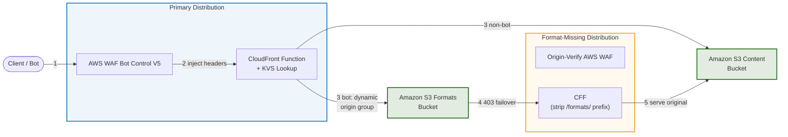
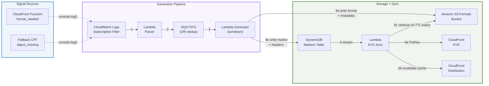
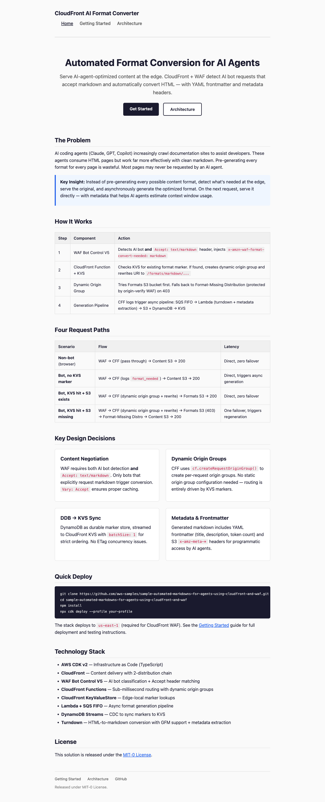

# Automated Format Conversion for AI Agents using Amazon CloudFront and AWS WAF

This AWS Cloud Development Kit (AWS CDK) sample demonstrates a generic pattern for serving AI-agent-optimized content at the edge. Amazon CloudFront + AWS WAF detect AI bot requests that accept markdown, serve pre-generated formatted content when available, and asynchronously generate it from HTML when not.

### Core Idea

Instead of pre-generating every possible content format, the system detects what's needed at the edge, serves the original, and asynchronously triggers generation of the required format. On subsequent requests, the generated format is served directly — with YAML frontmatter and metadata headers for AI agent consumption.

> **Standalone deployment:** This solution can also be deployed as a standalone layer in front of your existing CloudFront distribution or any other CDN — used purely for automatic format conversion and AI bot detection, without replacing your current content delivery setup.

---

## Architecture

### Request Flow (Synchronous)

How requests are classified, routed, and served through the 2-distribution chain.



**Four request paths:**

| Path | Failovers | Description |
|---|---|---|
| **Non-bot** (browser) | 0 | CFF passes through &#8594; Content Amazon S3 (200) |
| **Bot, no KVS marker** | 0 | CFF passes through, logs `format_needed` &#8594; Content Amazon S3 (200) |
| **Bot, KVS hit + S3 exists** | 0 | CFF creates dynamic origin group, rewrites URI &#8594; Formats Amazon S3 (200) |
| **Bot, KVS hit + S3 missing** | 1 | CFF creates dynamic origin group, rewrites URI &#8594; Formats Amazon S3 (403) &#8594; Format-Missing Distro &#8594; logs `object_missing` &#8594; Content Amazon S3 (200) |

### Generation Pipeline (Asynchronous)

How format misses are detected, deduplicated, and resolved.



**Pipeline steps:**

| Step | Component | Role |
|---|---|---|
| Signal | CFF `console.log()` | Emits `format_needed` or `object_missing` JSON |
| 1 | CloudWatch Subscription Filter | Routes matching log events to Parser Lambda |
| 2 | Parser Lambda | Decodes base64+gzip CW logs, sends to SQS FIFO |
| 3 | SQS FIFO | URI-based deduplication (`MessageDeduplicationId` = URI, 5 min window) |
| 4 | Generator Lambda | Fetches HTML via CloudFront, converts with turndown, extracts metadata, adds YAML frontmatter, writes S3 (with `x-amz-meta-*` headers) + DynamoDB |
| 5-6 | DDB Stream + KVS Sync Lambda | Syncs markers to CloudFront KVS (`batchSize: 1` for strict ordering), invalidates stale cached format path; on TTL expiry, deletes KVS key + S3 format file |

### Cache Strategy

The default behavior uses a **format-aware cache policy** that includes the AWS WAF-injected `x-amzn-waf-format-convert-needed` header in the cache key. This ensures bot and non-bot requests to the same URI maintain separate cache entries, preventing cached HTML from being served to bots that should receive formatted content.

A **response headers policy** adds `Vary: Accept` so downstream proxies and browsers also respect content negotiation.

| Behavior | Cache Policy | Rationale |
|---|---|---|
| Default (`/*`) | Format-aware (custom) | Separates bot vs non-bot cache entries via AWS WAF header |
| Static (`/static/*`) | `CachingOptimized` | No format conversion needed — aggressive caching |
| Formats (`/formats/*`) | `CachingOptimized` | Pre-generated content — standard caching |

---

## Prerequisites

- AWS account with [AWS CDK bootstrapped](https://docs.aws.amazon.com/cdk/v2/guide/bootstrapping.html) in `us-east-1`
- Node.js 18+
- AWS Command Line Interface (AWS CLI) configured

## Deploy

```bash
npm install
npx cdk deploy
```

The stack deploys to `us-east-1` (required for Amazon CloudFront AWS WAF).

## Test

Bot detection relies on the [AWS WAF Bot Control](https://docs.aws.amazon.com/waf/latest/developerguide/aws-managed-rule-groups-bot.html) managed rule group. Format conversion requires **both** an AI bot User-Agent **and** `Accept: text/markdown` in the request.

```bash
# Run CDK assertion tests
npm test

# After deployment — browser request (returns HTML)
curl https://<distribution-domain>/index.html

# AI bot request with Accept: text/markdown (first time returns HTML, triggers async generation)
curl -H "User-Agent: GPTBot/1.0" -H "Accept: text/markdown, text/html" \
  https://<distribution-domain>/blog/getting-started.html

# Wait ~30 seconds, then repeat — returns generated markdown with frontmatter
curl -H "User-Agent: GPTBot/1.0" -H "Accept: text/markdown, text/html" \
  https://<distribution-domain>/blog/getting-started.html
```

The markdown response includes YAML frontmatter and Amazon S3 metadata headers:

```
Content-Type: text/markdown; charset=utf-8
x-amz-meta-title: Getting Started
x-amz-meta-tokens: 1234
Vary: Accept

---
title: Getting Started
description: Deploy and test the solution
tokens: 1234
---

# Getting Started
...
```

## HTML → Markdown Comparison

The same page served to a browser (HTML) vs. an AI bot (markdown):

<table>
<tr>
<td align="center"><strong>Before — HTML (browser)</strong></td>
<td align="center"><strong>After — Markdown (AI bot)</strong></td>
</tr>
<tr>
<td valign="top"></td>
<td valign="top"></td>
</tr>
</table>

---

## Key Design Decisions

| Decision | Rationale |
|---|---|
| Content negotiation via Accept header | AWS WAF rule requires both AI bot label AND `Accept: text/markdown` — prevents unnecessary conversion for bots that don't need markdown |
| Separate content and formats buckets | Demonstrates the origin can be anything (Amazon S3, Application Load Balancer, Amazon API Gateway); formats bucket is independently managed |
| 2-distribution chain | Content &#8594; Formats (with dynamic origin group failover to Format-Missing distro) ensures graceful degradation without Lambda@Edge |
| AWS WAF-only bot detection | Bot Control V5 AI category labels — no UA pattern matching in CFF |
| Format-aware cache policy + Vary: Accept | AWS WAF header in cache key separates bot/non-bot responses; Vary header enables proper content negotiation at proxies |
| YAML frontmatter + Amazon S3 metadata | Generated markdown includes title, description, token count as frontmatter; same data in `x-amz-meta-*` headers for programmatic access |
| Extensible format paths | `/formats/<format>/` allows adding formats beyond markdown |
| AWS WAF do-not-convert rule | Regex Pattern Set updatable via AWS WAF console — no code changes needed |

## Do-Not-Convert Configuration

URI patterns can be excluded from format conversion via an AWS WAF Regex Pattern Set. Update patterns via the AWS WAF console or API:

```bash
aws wafv2 update-regex-pattern-set \
  --name DoNotConvertPatterns \
  --scope CLOUDFRONT \
  --id <pattern-set-id> \
  --lock-token <lock-token> \
  --region us-east-1 \
  --regular-expression-list '[{"RegexString": "/static/.*"}, {"RegexString": "/admin/.*"}]'
```

## Clean Up

```bash
npx cdk destroy
```

## Security

See [CONTRIBUTING](CONTRIBUTING.md#security-issue-notifications) for more information.

## License

This library is licensed under the MIT-0 License. See the LICENSE file.

