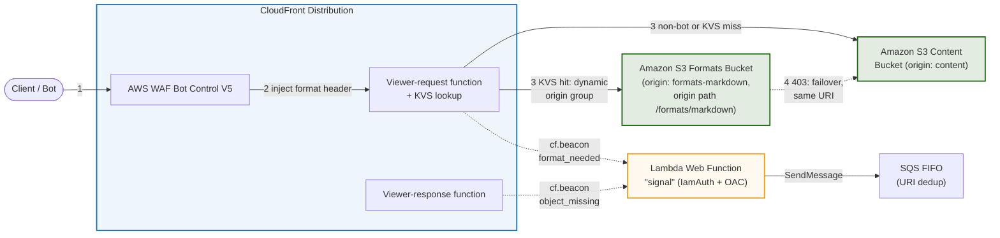
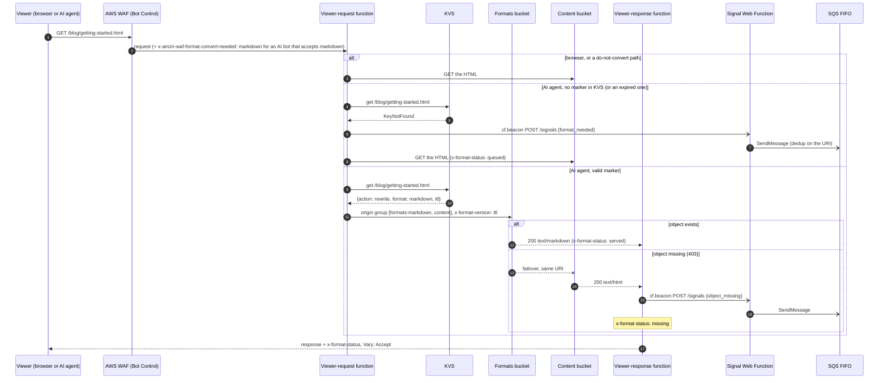
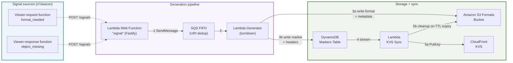
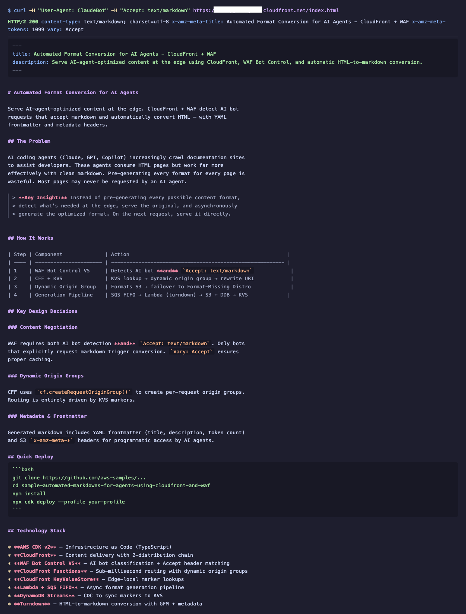

# Automated Format Conversion for AI Agents using Amazon CloudFront and AWS WAF

This AWS Cloud Development Kit (AWS CDK) sample demonstrates a generic pattern for serving AI-agent-optimized content at the edge. Amazon CloudFront + AWS WAF detect AI bot requests that accept markdown, serve pre-generated formatted content when available, and asynchronously generate it from HTML when not.

### Core Idea

Instead of pre-generating every possible content format, the system detects what's needed at the edge, serves the original, and asynchronously triggers generation of the required format. On subsequent requests, the generated format is served directly — with YAML frontmatter and metadata headers for AI agent consumption.

> **Standalone deployment:** This solution can also be deployed as a standalone layer in front of your existing CloudFront distribution or any other CDN — used purely for automatic format conversion and AI bot detection, without replacing your current content delivery setup.

---

## Architecture

One CloudFront distribution does the whole job. Two CloudFront Functions decide what each request gets, and when
a format is missing they say so with a **network call**: one `cf.beacon` to a small origin on the same
distribution, a Fastify server on a Lambda Web Function, which puts the job on an SQS FIFO queue. The generation
itself runs later, off the request path.

### Request flow (synchronous)





**Request paths:**

| Path | Network call | What the viewer gets |
|---|---|---|
| **Non-bot** (browser) | none | Original HTML from the content origin |
| **Bot, no KVS marker** (or an expired one) | `cf.beacon` `format_needed` from viewer request | Original HTML, `x-format-status: queued` |
| **Bot, KVS hit, object exists** | none | Markdown from the formats bucket, `x-format-status: served` |
| **Bot, KVS hit, object missing** | `cf.beacon` `object_missing` from viewer response | Original HTML (origin group failover), `x-format-status: missing` |

A function makes at most one network call per invocation, and a request and its response are two invocations, so
each path above stays within that rule. A beacon never delays the response. If it cannot be sent (the call throws),
the function logs `signal_failed`, sets `x-format-status: failed` and still serves the original.

### Generation pipeline (asynchronous)



**Pipeline steps:**

| Step | Component | Role |
|---|---|---|
| Signal | CloudFront Function `cf.beacon` | `POST /signals` with `{signal, uri, format}` to the `signal` origin; fire-and-forget, `logDeliveryErrors: true` |
| 1 | Signal Web Function | Validates the signal (known signal, a path, a known format) and sends one SQS FIFO message |
| 2 | SQS FIFO | URI-based deduplication (`MessageDeduplicationId` = URI, 5 min window): a burst of agents is one generation |
| 3 | Generator Lambda | Fetches HTML via CloudFront, converts with turndown, extracts metadata, adds YAML frontmatter, writes S3 (with `x-amz-meta-*` headers) + DynamoDB |
| 4-5 | DDB Stream + KVS Sync Lambda | Syncs markers to CloudFront KVS (`batchSize: 1` for strict ordering); on TTL expiry, deletes the KVS key and the S3 format file |

### Why network calls

The earlier version of this sample needed two pieces of indirection to tell the pipeline something from the edge:

- **Signals through logs.** The function wrote `format_needed` with `console.log`, a CloudWatch Logs subscription
  filter matched it, and a Parser Lambda decoded the gzipped log batch and sent it to SQS. Log delivery added
  seconds and a moving part whose only job was to carry one message.
- **A second distribution.** When a marker pointed at an object that was not in the formats bucket, the origin group
  failed over to a "format-missing" distribution (with its own AWS WAF web ACL and a shared-secret header) whose
  function stripped `/formats/<format>/` from the URI and logged `object_missing`.

With network calls a function sends the signal itself: one `cf.beacon` to an origin on the same distribution. The
second distribution is not needed either. The formats origin now has the origin path `/formats/<format>`, so the URI
is never rewritten and the content origin can be the failover directly. The only thing the second distribution
still did, noticing the miss, is done by a viewer-response function: it sees that the answer is not the format the
request was routed to and beacons `object_missing`.

The work that is slow stays off the request path. A beacon only asks; the conversion happens in the Generator Lambda
behind the queue.

### Why a Lambda Web Function for the signal origin

`cf.beacon` targets an origin on the distribution by origin id. The `signal` origin is a Fastify server
([functions/signal/app.mjs](functions/signal/app.mjs)) running on a Lambda Web Function:

- **Private by construction.** The endpoint uses `IamAuth`. CloudFront signs every request to it with an origin access
  control of type `lambda` (`always-amz-auth`), and the Web Function's resource policy allows
  `lambda:InvokeWebFunctionEndpoint` only for `cloudfront.amazonaws.com` from this distribution. No cache behavior
  points at the origin, so viewers cannot reach it through CloudFront, and a direct request to the endpoint domain
  gets 403. No shared secret to rotate.
- **No body hash.** CloudFront signs a `POST` to a Web Function with an unsigned payload, so the functions send plain
  JSON without an `x-amz-content-sha256` header.
- **A normal HTTP app.** Routes, validation and a 10 KB body limit (the `cf.beacon` limit) are ordinary Fastify code,
  tested with `app.inject` ([test/signal-origin.test.mjs](test/signal-origin.test.mjs)).
- **Fails safe.** A cold start can be longer than a network call's 1 second budget, and a beacon is not retried. A
  lost signal costs nothing: the agent already has the HTML, and its next request (or the next agent's) sends the
  signal again. With `logDeliveryErrors: true` CloudFront writes late delivery failures to the function's log group.

The Generator and KVS Sync Lambdas are not HTTP origins (an SQS consumer and a DynamoDB stream consumer), so they stay
normal Lambda functions.

### Cache strategy

The default behavior uses a **format-aware cache policy** whose cache key holds two headers:

- `x-amzn-waf-format-convert-needed`, injected by AWS WAF, so bot and non-bot requests for the same URI are separate
  cache entries.
- `x-format-version`, set by the viewer-request function to the marker's TTL when it routes to a format (viewer
  copies are dropped). A regenerated format gets a new marker and so a new cache entry at every edge. No
  invalidation is needed, and an HTML copy cached after a failover is never served once the format exists again.

A **response headers policy** adds `Vary: Accept` so downstream proxies and browsers also respect content negotiation.

| Behavior | Cache policy | Rationale |
|---|---|---|
| Default (`/*`) | Format-aware (custom) | Separates bot vs non-bot entries and format versions |
| Static (`/static/*`) | `CachingOptimized` | No format conversion needed, aggressive caching |

The formats and signal origins have no cache behavior. Only the functions use them.

---

## Prerequisites

- AWS account with [AWS CDK bootstrapped](https://docs.aws.amazon.com/cdk/v2/guide/bootstrapping.html) in `us-east-1`
- Node.js 22+ (the CDK app and the tests), with npm
- AWS Command Line Interface (AWS CLI) configured
- An account whose CloudFront distributions can use CloudFront Functions network calls (`cf.fetch` / `cf.beacon`).
  Network calls are not available on the free pricing plan or on distributions with continuous deployment.

## Deploy

```bash
npm install        # also installs the signal Web Function's own dependencies (functions/signal)
npx cdk deploy
```

The stack deploys to `us-east-1` (required for Amazon CloudFront AWS WAF). The signal Web Function's package is
built locally with `npm ci` (Docker is the fallback). To tag every resource, set a `tags` object in the CDK context,
for example in `cdk.json` or `~/.cdk.json`: `{"context": {"tags": {"team": "edge"}}}`.

## Test

Bot detection relies on the [AWS WAF Bot Control](https://docs.aws.amazon.com/waf/latest/developerguide/aws-managed-rule-groups-bot.html) managed rule group. Format conversion requires **both** an AI bot User-Agent **and** `Accept: text/markdown` in the request.

```bash
# Unit tests: function syntax checks, CDK assertions, both CloudFront Functions, the signal Web Function
npm test

# After deployment — browser request (returns HTML)
curl https://<distribution-domain>/index.html

# AI bot request with Accept: text/markdown (first time returns HTML with x-format-status: queued;
# the viewer-request function has beaconed format_needed)
curl -si -H "User-Agent: GPTBot/1.0" -H "Accept: text/markdown, text/html" \
  https://<distribution-domain>/blog/getting-started.html | grep -iE '^(HTTP|content-type|x-format-status)'

# Wait about a minute (generation, then KVS propagation), then repeat: markdown with frontmatter,
# x-format-status: served
curl -si -H "User-Agent: GPTBot/1.0" -H "Accept: text/markdown, text/html" \
  https://<distribution-domain>/blog/getting-started.html
```

To see the missing-object path, delete the generated object while its marker is still valid. The next agent request
gets the HTML through the origin group failover with `x-format-status: missing`; the viewer-response function has
beaconed `object_missing`, and about a minute later the markdown is back:

```bash
aws s3 rm s3://<formats-bucket>/formats/markdown/blog/getting-started.html
curl -si -H "User-Agent: GPTBot/1.0" -H "Accept: text/markdown, text/html" \
  https://<distribution-domain>/blog/getting-started.html | grep -iE '^(content-type|x-format-status)'
```

A direct request to the signal Web Function's endpoint (stack resource `EdgeLayer/Signal`) is refused with 403:
only CloudFront, signing for this distribution, may invoke it.

The markdown response includes YAML frontmatter and Amazon S3 metadata headers:

```
Content-Type: text/markdown; charset=utf-8
x-amz-meta-title: Getting Started
x-amz-meta-tokens: 1234
Vary: Accept

---
title: Getting Started
description: Deploy and test the solution
tokens: 1234
---

# Getting Started
...
```

## HTML → Markdown Comparison

The same page served to a browser (HTML) vs. an AI bot (markdown):

<table>
<tr>
<td align="center"><strong>Before — HTML (browser)</strong></td>
<td align="center"><strong>After — Markdown (AI bot)</strong></td>
</tr>
<tr>
<td valign="top"></td>
<td valign="top"></td>
</tr>
</table>

---

## Key Design Decisions

| Decision | Rationale |
|---|---|
| Content negotiation via Accept header | AWS WAF rule requires both AI bot label AND `Accept: text/markdown` — prevents unnecessary conversion for bots that don't need markdown |
| Separate content and formats buckets | Demonstrates the origin can be anything (Amazon S3, Application Load Balancer, Amazon API Gateway); formats bucket is independently managed |
| One distribution, network calls for signals | `cf.beacon` from the functions to a Web Function origin replaces the log subscription, the Parser Lambda and the format-missing distribution |
| Origin path per format, content origin as failover | The URI is never rewritten, so a missing object falls back to the original with no prefix stripping and no Lambda@Edge |
| Format version in the cache key | A new marker is a new cache entry, so no invalidations after generation |
| Fastify on a Lambda Web Function behind OAC | IamAuth endpoint, invokable only by this distribution; no shared secret, no body hash |
| AWS WAF-only bot detection | Bot Control V5 AI category labels — no UA pattern matching in CFF |
| Format-aware cache policy + Vary: Accept | AWS WAF header in cache key separates bot/non-bot responses; Vary header enables proper content negotiation at proxies |
| YAML frontmatter + Amazon S3 metadata | Generated markdown includes title, description, token count as frontmatter; same data in `x-amz-meta-*` headers for programmatic access |
| Extensible format paths | `/formats/<format>/` in the formats bucket; a new format adds a converter, an entry in `FORMAT_CONTENT_TYPES` and so an origin `formats-<format>` |
| AWS WAF do-not-convert rule | Regex Pattern Set updatable via AWS WAF console — no code changes needed |

## Do-Not-Convert Configuration

URI patterns can be excluded from format conversion via an AWS WAF Regex Pattern Set. Update patterns via the AWS WAF console or API:

```bash
aws wafv2 update-regex-pattern-set \
  --name DoNotConvertPatterns \
  --scope CLOUDFRONT \
  --id <pattern-set-id> \
  --lock-token <lock-token> \
  --region us-east-1 \
  --regular-expression-list '[{"RegexString": "/static/.*"}, {"RegexString": "/admin/.*"}]'
```

## Cost

What this sample adds per request, on top of CloudFront and AWS WAF (with Bot Control) request pricing:

- **CloudFront Functions**: the viewer-request function runs on every request to the default behavior, the
  viewer-response function on every response to it. See [Amazon CloudFront pricing](https://aws.amazon.com/cloudfront/pricing/)
  for function invocations and network calls.
- **Signals**: one `cf.beacon` and one short Web Function invocation per AI-agent request with no valid marker (and
  per response with a missing object). Browsers and agents that get the format cause none. The FIFO queue
  collapses repeats of a URI within 5 minutes into one generation. See [AWS Lambda pricing](https://aws.amazon.com/lambda/pricing/)
  and [Amazon SQS pricing](https://aws.amazon.com/sqs/pricing/).
- **Generation**: one Generator Lambda run, one S3 PUT and one DynamoDB write per generated page, and one KVS Sync
  run per marker change.
- **Removed**: the second distribution and its web ACL, the CloudWatch Logs subscription filters and Parser Lambda,
  and the CloudFront invalidations after each generation.

## Clean Up

```bash
npx cdk destroy
```

This deletes the distribution, both buckets and their objects, the queue, the table, the KVS, the Lambda and Web
Functions and the log groups the stack owns (the CloudFront Function and Web Function log groups included).

## Security

See [CONTRIBUTING](CONTRIBUTING.md#security-issue-notifications) for more information.

## License

This library is licensed under the MIT-0 License. See the LICENSE file.

